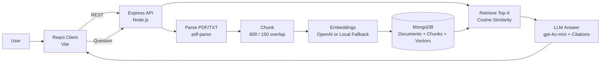

# DocMind AI — RAG Chatbot

> Chat with your documents. Upload a PDF or text file, ask questions in plain English, and get answers grounded **only** in that document — with sources cited for every answer.

Built by **Muneeb Ahmed** as a Full Stack **MERN + Generative AI** portfolio project.

 

## What it does

- Upload PDF / TXT / MD documents (drag & drop)
- The document is automatically split, embedded and stored as vectors
- Ask any question — DocMind retrieves the most relevant passages and generates an answer **with citations** (source chunk + relevance %)
- View how your document was chunked (chunk count + previews) — the RAG pipeline is transparent, not a black box
- Works **with zero config**: no MongoDB and no OpenAI key? It still runs (in-memory store + local embeddings + extractive answers) so anyone can demo it in 2 minutes

## Architecture



## Tech Stack

| Layer | Tech |
|---|---|
| Frontend | React 18, Vite, plain CSS (dark SaaS UI) |
| Backend | Node.js, Express, Multer, Mongoose |
| Database | MongoDB Atlas (or in-memory fallback) |
| AI — Embeddings | OpenAI `text-embedding-3-small` (or deterministic local TF/hash fallback) |
| AI — Chat | OpenAI `gpt-4o-mini` (or extractive fallback) |
| Parsing | `pdf-parse` for PDFs, native text for TXT/MD |

## How RAG works here — step by step

1. **Upload** — `POST /api/documents` receives the file via Multer (10 MB limit).
2. **Extract** — PDFs are parsed with `pdf-parse`; TXT/MD are read as UTF-8 text.
3. **Chunk** — Text is cleaned and split into **800-character chunks with 150-character overlap**, preferring sentence boundaries. Overlap keeps context from being lost at chunk edges.
4. **Embed** — Each chunk is turned into a vector: OpenAI `text-embedding-3-small` when a key is set, otherwise a deterministic local embedding (token hashing + TF weighting, 384 dims, L2-normalised).
5. **Store** — Documents and Chunks (text + index + embedding array) are stored in MongoDB via Mongoose models — or in memory when `MONGODB_URI` is empty.
6. **Retrieve** — A question is embedded the same way, **cosine similarity** is computed against every chunk, and the **top 4** chunks are selected.
7. **Generate** — The top chunks are sent to `gpt-4o-mini` with an instruction to answer *only* from the sources and cite them as `[Source n]`. Without a key, an extractive fallback composes an answer from the most question-relevant sentences in those chunks.
8. **Cite** — The UI shows every source: chunk number, excerpt, and relevance %.

> Honest note: the local embedding fallback captures keyword overlap well enough for demos, but it is not semantic like a real embedding model. Add an OpenAI key for production-quality retrieval.

## Features

- ✅ Drag-and-drop document upload (PDF / TXT / MD)
- ✅ Automatic chunking + embedding pipeline with processing status
- ✅ Semantic retrieval (top-K, cosine similarity)
- ✅ Grounded answers with source citations + relevance scores
- ✅ Document list, detail view with chunk previews, delete
- ✅ Suggested questions for the sample document
- ✅ Zero-config demo mode (no Mongo / no OpenAI key needed)
- ✅ Clear offline banner — the client never fakes data when the API is down

## Quick Start

### Option A — Zero config (fastest demo, 2 minutes)

```bash
# terminal 1
cd server && npm install && npm run dev     # http://localhost:5000
# terminal 2
cd client && npm install && npm run dev     # http://localhost:5173
```

Open http://localhost:5173, upload `samples/employee-handbook.txt`, and ask:
- *"How many vacation days do employees get?"*
- *"What is the remote work policy?"*

### Option B — Full setup (MongoDB Atlas + OpenAI)

1. Create a free cluster at [MongoDB Atlas](https://www.mongodb.com/atlas), copy its connection string.
2. Get an API key from [OpenAI](https://platform.openai.com/api-keys).
3. Copy `server/.env.example` to `server/.env` and fill in:

```env
PORT=5000
MONGODB_URI=mongodb+srv://<user>:<password>@<cluster>/docmind
OPENAI_API_KEY=sk-...
OPENAI_CHAT_MODEL=gpt-4o-mini
OPENAI_EMBEDDING_MODEL=text-embedding-3-small
CLIENT_URL=http://localhost:5173
```

4. Run as above — `/api/health` will now report `store: "mongodb"` and `embeddingMode: "openai"`.

### Run both together from the root

```bash
npm run install:all
npm run dev    # uses concurrently — server + client
```

## API Endpoints

| Method | Endpoint | Description |
|---|---|---|
| GET | `/api/health` | Service status, store mode, embedding mode, OpenAI/Mongo config |
| POST | `/api/documents` | Upload a document (form field `file`). Extracts, chunks, embeds, stores. |
| GET | `/api/documents` | List all documents with chunk/char counts and status |
| GET | `/api/documents/:id` | One document + chunk previews |
| DELETE | `/api/documents/:id` | Delete a document and all its chunks |
| POST | `/api/chat` | `{ question, documentId? }` → answer + mode + sources (top-4, with relevance %) |

## Project Structure

```
rag-chatbot/
├── client/            # Vite + React UI
│   └── src/           # App.jsx, api.js, styles.css
├── server/
│   ├── sample.txt
│   └── src/
│       ├── models/    # Mongoose Document + Chunk
│       ├── services/  # chunking, embeddings, llm, store abstraction
│       ├── routes/    # documents, chat
│       └── index.js   # Express app
├── samples/           # employee-handbook.txt for instant demo
└── README.md
```

## Screenshots

> _Add screenshots here after running it: 1) upload + document list, 2) a chat answer with sources expanded, 3) chunk previews._
>
> `docs/screenshot-chat.png` · `docs/screenshot-upload.png`

## Upwork Portfolio Description (copy-paste)

**DocMind AI — RAG Chatbot (MERN + OpenAI)**

*I built a complete Retrieval-Augmented Generation (RAG) chatbot that lets users chat with their own documents. Users upload a PDF, the system extracts and chunks the text, generates embeddings, stores the vectors in MongoDB, retrieves the most relevant passages by cosine similarity, and generates a grounded answer with source citations using OpenAI.*

*Stack: MongoDB, Express, React, Node.js, OpenAI API (embeddings + chat), pdf-parse, Mongoose, Vite.*

*Highlights: full RAG pipeline built from scratch (no LangChain black box), transparent chunk/retrieval inspection in the UI, and graceful fallbacks so the app demos with no API key. This is the same architecture I use to build AI chatbots, document Q&A tools, and GenAI features for client SaaS products.*

## Limitations / Next steps

- Chunk search is an in-memory cosine scan — perfect for demos/small corpora; at scale, move to MongoDB Atlas Vector Search or a dedicated vector DB.
- No auth / multi-tenancy yet; one shared document space.
- PDF parsing is text-only (no OCR for scanned PDFs, no tables/images).
- Next: streaming answers, chat history in MongoDB, multiple-file chat, Atlas Vector Search index.

## License

MIT — free to use as a portfolio / learning project.
